# Ship chandlery demand forecast

A demand forecast for a ship chandler: how much provisions, fresh water, lubricants, deck and engine stores, and safety equipment to put on the next order, given the vessels due alongside.

Silent Ramihel Limited supplies ships calling at port and builds the forecasting and planning tools that sit behind that work. This repository is the public demo of the data-science line. It uses the chandlery problem because the same morning decision — read the lineup, forecast the book, place the order — is where the two practices meet.

> **Synthetic data.** There is no client extract in this repo. Vessel calls, order quantities, prices, and the error figures below were produced by a seeded generator (`SEED = 42`). They are not measurements from Mombasa, Dar es Salaam, Djibouti, Durban, or any ship. The ports are named so the story is easy to tell. The numbers attached to them are invented.

## The decision

A chandler does not stock against a smooth average. Monday is heavy because Sunday arrivals are booked the next open day. A cruise call moves provisions. A quiet Sunday is close to the walk-in floor. Safety gear is sparse until a survey season. The purchase has a lead time, and the next time someone reviews the stock is days away, so the order has to cover both.

The demo lets you pick a port, a category, and a review cycle, then shows:

- a daily forecast and a 90% band
- the vessel lineup those days are based on
- a suggested order at a chosen service level, net of stock on hand and inbound

## Approach

The generator builds the book in three steps, all documented in `chandlery_forecast/generate.py`.

1. **Calls.** Each port has a stylised arrival rate that moves with month, weekday, a slow trend, and a handful of named, invented disruptions. Each call gets a type, a size, a crew, and a voyage length.
2. **Orders.** Some calls buy. Provisions scale with people and voyage length. Lubricants scale with size. Safety equipment is a small basket and is ordered more often in a stylised March and September. A closed desk (Sunday or a public holiday) pushes the booking to the next open day.
3. **Daily demand.** Orders on a day are summed, a small walk-in baseline is added, and a port-level shock is applied. The panel is complete: every port, category, and day from 1 Jan 2022 through 30 Sep 2026.

The forecast model does not see voyage length or the coin-flip of whether the master buys. It sees what a chandler can see from pre-arrival notices: how many ships, how large, what type, and a rough crew, plus the history of the chandler's own book.

| Model | What it uses |
| --- | --- |
| Seasonal naive (7-day) | Repeats last week |
| Holt-Winters (weekly) | Additive weekly exponential smoothing, refit at each origin |
| Fourier ridge | Lags, rolling stats, calendar terms, port and category. No lineup |
| Gradient boosting | Same information as the ridge model, non-linear |
| Gradient boosting + lineup | The same booster, plus the target day's vessel lineup |

The boosters are histogram gradient-boosting models fit on `log1p(demand)`, direct (the horizon is a feature, not a recursion), then rescaled by a category multiplier estimated on the last 90 days before the cutoff. Log-space error otherwise tracks a median and comes out short of the mean, which is the wrong quantity to buy.

**Backtest.** Models that use features are fit only on targets on or before **31 Mar 2026**. From that morning, and every 14 days after it, each model forecasts the next 7, 14, and 28 days. Holt-Winters and the naive model are refit from each series at each origin. Nothing in the scored window was a training target.

Error is reported in **synthetic USD** (quantity times a made-up basket price) so kilograms are not added to litres. WAPE is the sum of absolute errors divided by the sum of actual value. MASE divides daily error by the in-sample seasonal-naive error; 1.0 would match that naive scale.

The order is a base-stock quantity. Goods arrive after the lead time. The review cycle is the horizon you pick. Stock on hand and inbound have to cover lead time plus the review cycle, plus safety stock from the backtest residual at the chosen service level.

## Results on the synthetic holdout

Fourteen-day totals are the purchase. Daily error is the pick-and-pack. Both are value-weighted across the four ports and five categories. Twelve origins, from 31 Mar 2026 through 1 Sep 2026.

| Model | Lineup | Daily WAPE | Daily MASE | 14-day total WAPE |
| --- | ---: | ---: | ---: | ---: |
| Seasonal naive (7-day) | no | 90.6% | 0.95 | 32.0% |
| Holt-Winters (weekly) | no | 68.9% | 0.72 | 21.0% |
| Fourier ridge | no | 62.0% | 0.65 | 27.1% |
| Gradient boosting | no | 66.7% | 0.70 | 23.8% |
| **Gradient boosting + lineup** | **yes** | **44.1%** | **0.45** | **15.5%** |

Reading it in the order a buyer cares about:

- On the **14-day order**, the lineup model cuts value-weighted error from 32.0% (repeat last week) and 21.0% (Holt-Winters) to **15.5%**.
- The same booster **without** the lineup is at 23.8%. Most of the gain over a classical smoother is the lineup, not the choice of algorithm.
- On **individual days** the gap is wider (44.1% versus 90.6% naive). A fortnight lets some of the daily misses cancel; a truck loaded tomorrow does not.
- Safety equipment stays the hard category. It is a sparse buy. The lineup still beats the naive model there (24.2% versus 65.2% on the 14-day total), and it does not pretend the series is as regular as provisions.

14-day total WAPE by category, lineup model versus seasonal naive:

| Category | Naive | Boosting + lineup |
| --- | ---: | ---: |
| Provisions | 20.9% | 9.5% |
| Fresh water | 25.6% | 14.0% |
| Deck & engine stores | 32.6% | 16.8% |
| Lubricants | 39.9% | 19.5% |
| Safety equipment | 65.2% | 24.2% |

These percentages are errors on the generated holdout. They are not a claim about live accuracy in any port.

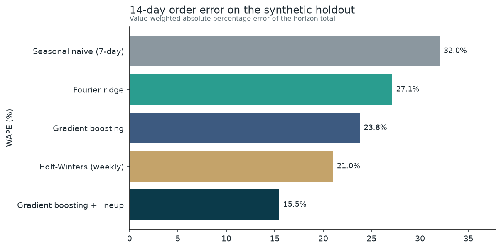

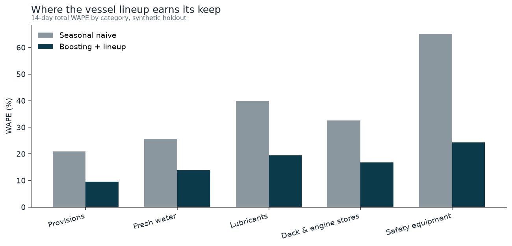

## What the book looks like

Mombasa provisions in the synthetic book. The weekly pulse is the desk calendar. The slower swing is the seasonal index plus the mix of ships.

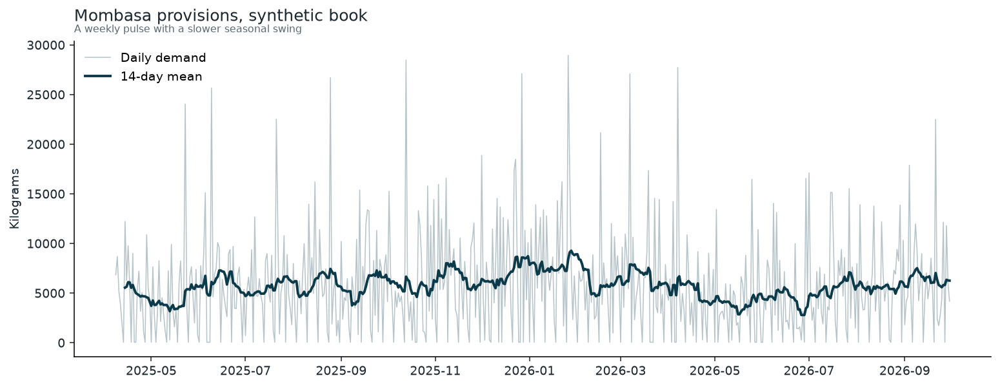

Sunday arrivals are not lost. They are booked on Monday, which is why the desk day is heavier than the arrival day.

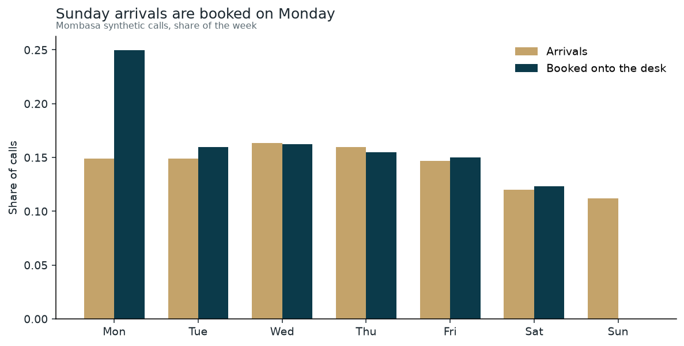

Crew on the lineup and provisions move together (correlation about 0.90 on synthetic Mombasa days). The scatter is not a line: voyage length and the decision to buy at all are still hidden from the model.

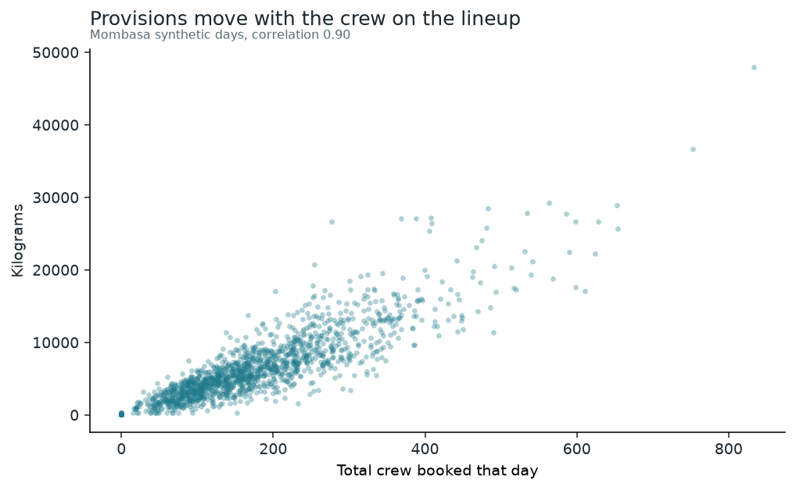

Each category has its own shape. Fresh water is higher in the hotter months in this generator. Safety equipment jumps in the stylised survey months. Provisions rise toward December.

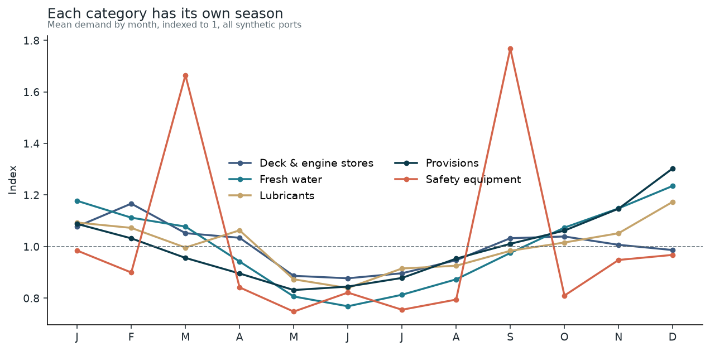

Holdout paths for two series. The lineup model follows the spikes the weekly naive misses. Blocks do not overlap, and the fit stopped at 31 Mar 2026.

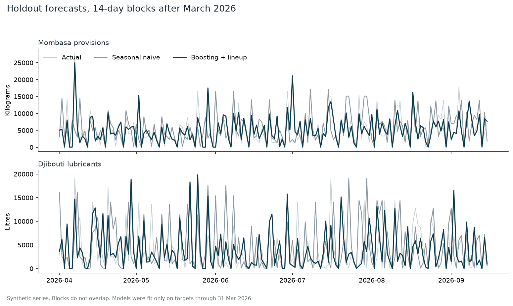

Shuffling crew, deadweight, or the call count on a late training slice hurts. Category matters because the five books are on different scales and were fit together.

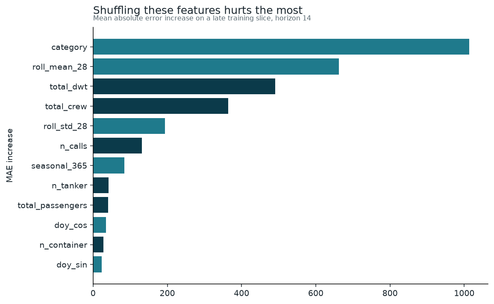

One replenishment window, Mombasa provisions, origin 23 Jun 2026. The band is the backtest residual at that horizon, drawn at 90%.

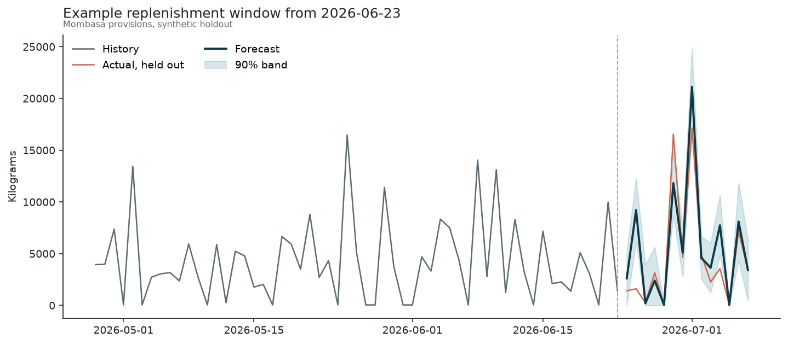

The walkthrough in `notebooks/demand_forecast_walkthrough.ipynb` repeats this argument with the code that loads the book, the metrics, and one suggested order.

The Streamlit app is the same forecast the table is about. Defaults open on Mombasa provisions, out of sample, with the holdout WAPE for that category next to the suggested order.

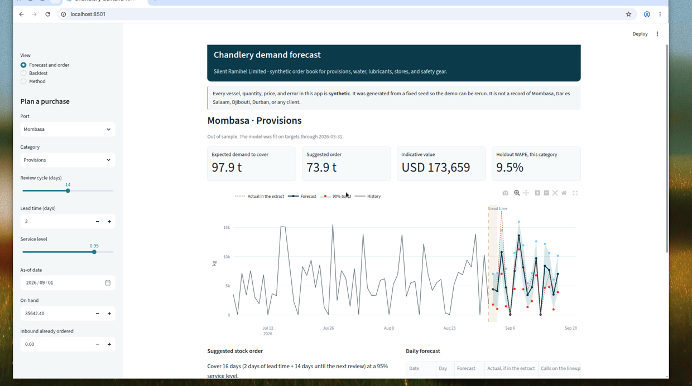

The backtest view is the holdout table, in synthetic USD.

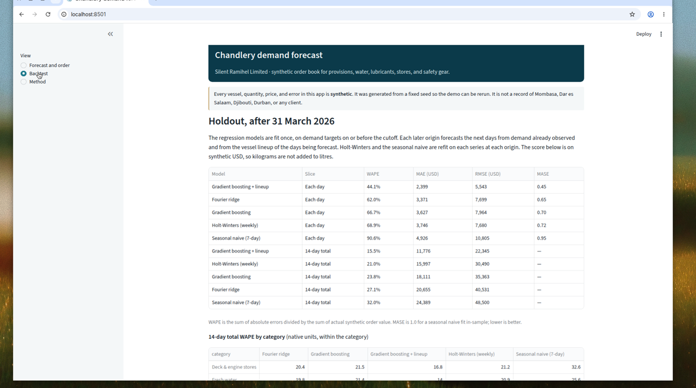

## Run it

Python 3.12. From the repo root:

```bash
python -m venv .venv
source .venv/bin/activate
make install
make data     # rewrite data/synthetic from seed 42
make train    # backtest, figures, and models/forecast_bundle.joblib
make test
make app      # Streamlit on http://localhost:8501
```

`make train` already runs `make data`. The committed `data/synthetic/` and `models/forecast_bundle.joblib` are the run behind the table above, so the app starts without a refit. Regenerating is deterministic for this generator version.

To refresh the notebook outputs:

```bash
make notebook
```

## Streamlit Community Cloud

The app is not deployed from here. To put it on Community Cloud:

1. Use this repository and the `main` branch after the demo is merged.
2. Set the main file to `app.py`. `runtime.txt` asks for Python 3.12. Dependencies are in `requirements.txt`.
3. Add no secrets. The app reads the committed synthetic CSVs and the model bundle.
4. Open the app, pick a port and a category, and change the review cycle. The order quantity should move.

If you fork and retrain, commit the new `data/synthetic/` and `models/forecast_bundle.joblib` or the cloud app will not find them.

## Project structure

```
app.py                          Streamlit entry point
chandlery_forecast/
  config.py                     Synthetic assumptions, named and commented
  generate.py                   Seeded order book
  features.py                   Direct multi-horizon design matrix
  models.py                     Naive, Holt-Winters, ridge, gradient boosting
  backtest.py                   Rolling-origin evaluation
  inventory.py                  Lead time, review cycle, safety stock
  pipeline.py                   Train, score, write reports
  plotting.py                   Figures under reports/figures
scripts/generate_data.py
scripts/train_evaluate.py
notebooks/demand_forecast_walkthrough.ipynb
tests/                          Generator, leakage, metrics, order math, backtest
.github/workflows/ci.yml        pytest on Python 3.12
```

## Tests

`make test` covers determinism, the Sunday booking rule, lag timing (including that a future spike does not change past features), agreement between the training frame and the forecast frame, the seasonal naive path, non-negative model output, the order formula, and a small rolling-origin backtest that only scores dates after its cutoff. The GitHub Actions workflow runs the same suite. It does not refit the full holdout.

## Caveats

- The demand equations are the author's assumptions. A real book of invoices would replace them. The evaluation design would stay: a cutoff, rolling origins, and an error measured on the order, not on a shuffled row.
- The lineup in the backtest is the realised booking, treated as if the agent already held those ETAs. A live feed is wrong about ships that slip a day. That error is not in this generator.
- Basket prices are round synthetic figures used only to put categories on one scale and to show an order value.
- Holiday dates, including Eid and Ramadan, are fixed inputs to the generator. They are not a religious or legal calendar.
- The 90% band is an empirical residual scale, not a formal prediction interval.

---

Built by Silent Ramihel Limited · [silentramihellimited@gmail.com](mailto:silentramihellimited@gmail.com)
